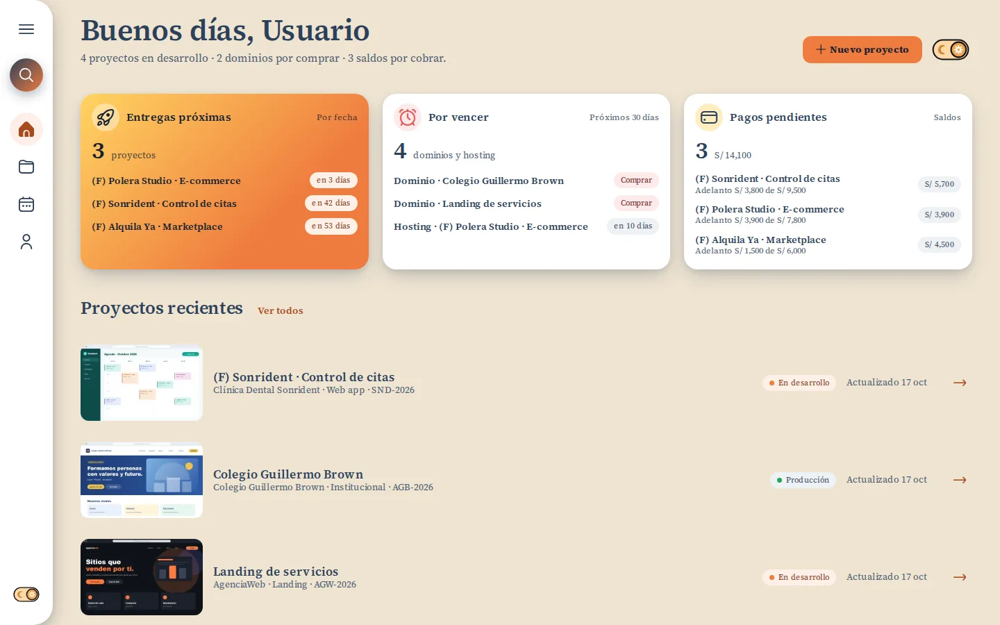
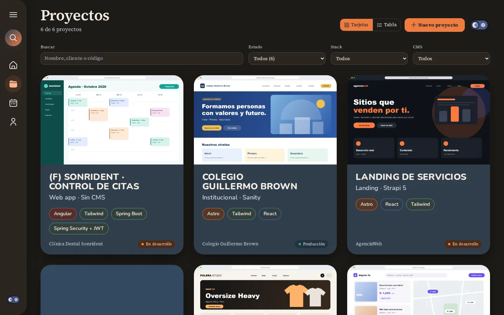
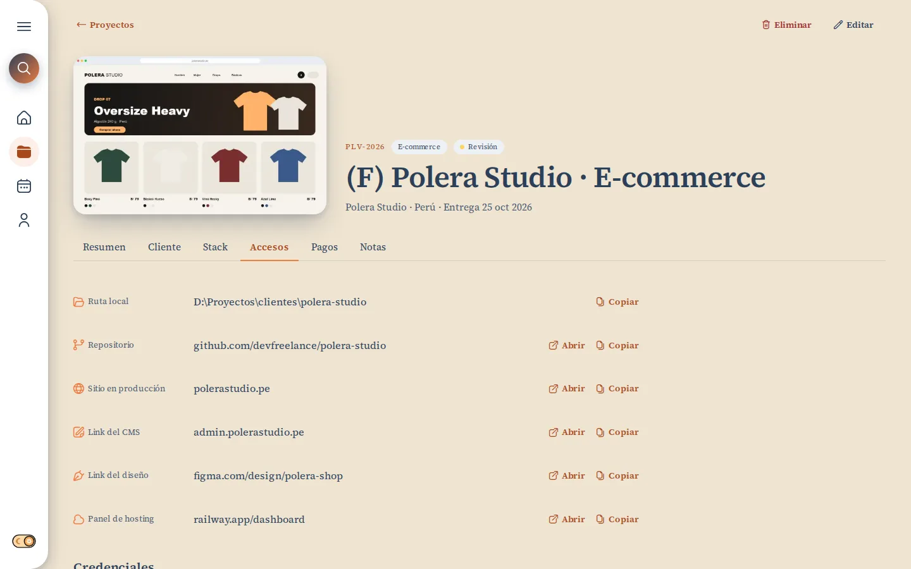
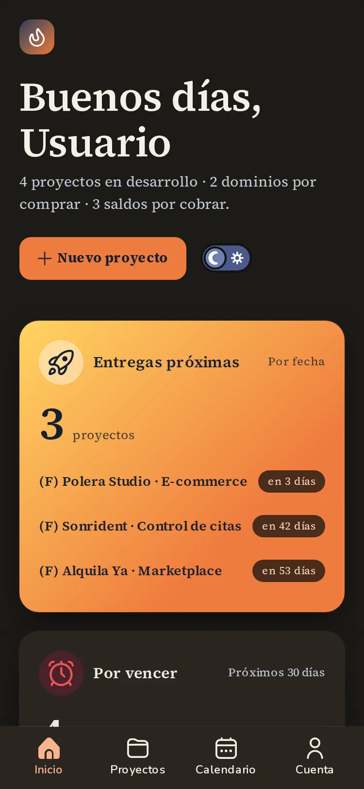
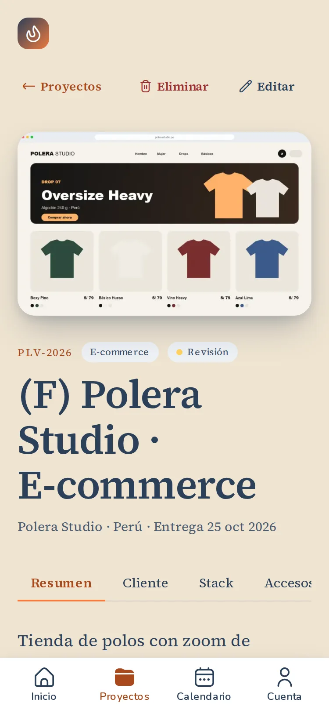

# Taller Freelancer

[](https://github.com/yrvin-dev/taller-freelancer/actions/workflows/ci.yml)

Dashboard para que un freelancer administre sus proyectos de cliente en un solo lugar: stack, accesos, enlaces, pagos, vencimientos de dominio y hosting, y una bitácora por proyecto. Entras con Google y cada usuario ve solo sus datos.

**En producción:** [taller-freelancer.vercel.app](https://taller-freelancer.vercel.app). Se entra con Google y cada cuenta empieza vacía.



| Proyectos (tema oscuro)                                                                                     | Ficha · Accesos                                                                                                 |
| ----------------------------------------------------------------------------------------------------------- | --------------------------------------------------------------------------------------------------------------- |
|  |  |

| Mobile · inicio                                                                                                                           | Mobile · ficha                                                                                                 |
| ----------------------------------------------------------------------------------------------------------------------------------------- | -------------------------------------------------------------------------------------------------------------- |
|  |  |

## Qué hace

- **Proyectos** con búsqueda y filtros (estado, stack, CMS) que viven en la URL: se comparten y sobreviven a la recarga. Vista en tarjetas o en tabla.
- **Ficha** con pestañas: resumen, cliente, stack, accesos, pagos y notas.
- **Miniatura** por proyecto en Supabase Storage (bucket privado con política por dueño). El servidor la convierte a WebP sin metadatos y se muestra con URL firmadas.
- **Credenciales de clientes cifradas** (AES-256-GCM). Solo se descifran en el servidor cuando pulsas "Mostrar".
- **Pagos** con saldo y avance, y actualizaciones optimistas (la UI responde al instante y se revierte sola si el servidor rechaza).
- **Calendario** de entregas y vencimientos, y un inicio con lo urgente: entregas próximas, dominios por renovar y saldos por cobrar.
- Tema claro y oscuro sin parpadeo, en mobile y desktop, con accesibilidad AA.

## Stack

| Capa         | Herramienta                                                  | Por qué                                                                            |
| ------------ | ------------------------------------------------------------ | ---------------------------------------------------------------------------------- |
| Framework    | Next.js 15 (App Router), React 19, TypeScript strict         | Server Components y Server Actions: sin API aparte para una app detrás de login.   |
| Datos y auth | Supabase: Postgres, Auth (Google OAuth) y Row Level Security | La autorización vive en la base: aunque falle el frontend, nadie lee datos ajenos. |
| Validación   | Zod                                                          | Un mismo esquema valida el formulario y la Server Action.                          |
| Formularios  | React Hook Form                                              |                                                                                    |
| Estilos      | Tailwind CSS 3.4 sobre CSS custom properties                 | Los tokens de diseño son la única fuente de color, radio y sombra.                 |
| Tests        | Vitest + Testing Library, Playwright + axe, Lighthouse       | Unitarios, integración contra la base real, e2e y accesibilidad.                   |
| CI/CD        | GitHub Actions → Vercel                                      | Previews por PR y producción en `main`.                                            |

## Decisiones que vale la pena mirar

- **RLS como autorización real.** Cada tabla tiene políticas por `auth.uid()`, y los tests de integración lo comprueban con dos usuarios: A no puede leer ni escribir lo de B. Con RLS, un `update` sobre una fila ajena no da error (afecta 0 filas), así que las acciones piden `.select()` y tratan "0 filas" como fallo. La `service_role` aparece en un solo módulo `server-only`, para borrar la cuenta, y el id del usuario sale de la sesión, nunca del navegador.
- **Cifrado con versión de clave.** Cada secreto guarda la versión de `CREDENTIALS_KEY` con la que se cifró. `pnpm rotate-key` re-cifra todo con una clave nueva (con `--dry-run` para practicar). Las credenciales nunca van en el HTML inicial ni en el export JSON.
- **Server Actions validadas y tipadas.** Todas validan con Zod y devuelven `{ ok, error }`. Si la sesión venció, la UI abre un diálogo para volver a entrar en lugar de fallar en silencio.
- **CSP con nonce por pedido.** `script-src` solo acepta scripts con el nonce del pedido (sin `unsafe-inline` ni `unsafe-eval`). El tema se lee de una cookie en el servidor, así que no hace falta un script inline para evitar el parpadeo. Un e2e recorre todas las rutas y falla ante cualquier violación de CSP.
- **Tokens como única fuente de diseño.** Ningún color hex o rgb fuera de `tokens.css`: lo bloquean una regla de ESLint y un `grep` en CI. Un test mide el contraste AA de cada par de texto en los dos temas.
- **Fechas y montos sin sorpresas.** "Hoy" se calcula en hora de Lima (el servidor corre en UTC) y los montos se suman en céntimos enteros.

## Calidad

- **Unitarios** (Vitest): esquemas, formato, cifrado (incluida la manipulación del tag), componentes y páginas.
- **Integración** contra la Supabase local: políticas de RLS, Server Actions, cifrado de punta a punta y borrado de cuenta.
- **e2e** (Playwright) contra el build de producción, en desktop (1440 px) y mobile (375 px): crear un proyecto con miniatura → filtrar → pagos → notas → credencial → eliminar; rutas protegidas y 404; cabeceras y CSP.
- **Accesibilidad**: axe (WCAG 2.2 AA) en cada ruta y diálogo, en los dos temas; navegación por teclado y objetivos táctiles de 44 px; Lighthouse 100 en accesibilidad.

La CI corre todo en cada PR. Incluye levantar Supabase en el runner y comprobar que `database.types.ts` coincide con las migraciones.

### Algo que encontraron los e2e

Cambiar de pestaña en la ficha a veces no hacía nada, **solo en producción**. En `pnpm dev` no pasaba nunca y ningún test unitario lo podía ver. La causa: un `loading.tsx` por encima de una página que navega solo por `searchParams` deja ese segmento sin datos en Next 15.5, y una carrera entre dos respuestas dejaba la transición suspendida para siempre. Se encontró midiendo cada variante con muchas corridas contra el build, porque con un fallo del 50 % una pasada sola no prueba nada. Quedó fijado con un test que impide volver a introducirlo (`tests/unit/loading-boundaries.test.ts`).

## Correrlo en local

Requisitos: Node 22, pnpm 12 y Docker (para la Supabase local).

```bash
pnpm install
pnpm db:start                 # Supabase en Docker: migraciones + datos de ejemplo
cp .env.example .env.local    # completa con `pnpm supabase status`
                              # CREDENTIALS_KEY: openssl rand -base64 32
pnpm dev
```

Para entrar con Google en local, las credenciales de OAuth van en `supabase/.env` (`SUPABASE_AUTH_EXTERNAL_GOOGLE_CLIENT_ID` y `..._SECRET`). Después, `pnpm db:seed-me tu@correo.com` copia los proyectos de ejemplo a tu cuenta.

| Comando                                      | Qué hace                                                              |
| -------------------------------------------- | --------------------------------------------------------------------- |
| `pnpm lint` · `pnpm typecheck` · `pnpm test` | Calidad y tests unitarios                                             |
| `pnpm test:integration`                      | Contra la Supabase local (RLS, acciones, cifrado)                     |
| `pnpm test:e2e`                              | Compila un build propio (`.next-e2e`, puerto 3100) y corre Playwright |
| `pnpm a11y:lighthouse`                       | Lighthouse (accesibilidad) en todas las rutas y los dos temas         |
| `pnpm screenshots`                           | Regenera las capturas de este README                                  |
| `pnpm rotate-key`                            | Re-cifra las credenciales con una clave nueva                         |

## Estructura

```
src/
  app/(app)/        páginas privadas y sus Server Actions (actions.ts)
  app/(auth)/       login con Google
  components/       UI portada del diseño (ui/, layout/, projects/…)
  lib/              dominio, esquemas Zod, formato, cifrado, cabeceras de seguridad
  lib/data/         lecturas de datos (server-only)
  styles/tokens.css única fuente de color, radio, sombra y espaciado
supabase/           migraciones, políticas RLS y seed
tests/              unit/, integration/, e2e/
docs/               requerimientos, design system, arquitectura y plan por tandas
```

El proyecto se construyó por tandas pequeñas y verificables (`docs/04-plan.md`). Lo aprendido en el camino está en la sección _Gotchas_ de `CLAUDE.md`.

## Licencia

Código publicado como portafolio: se puede leer y revisar, pero todos los derechos están reservados. No se permite copiarlo ni reutilizarlo sin permiso del autor.
